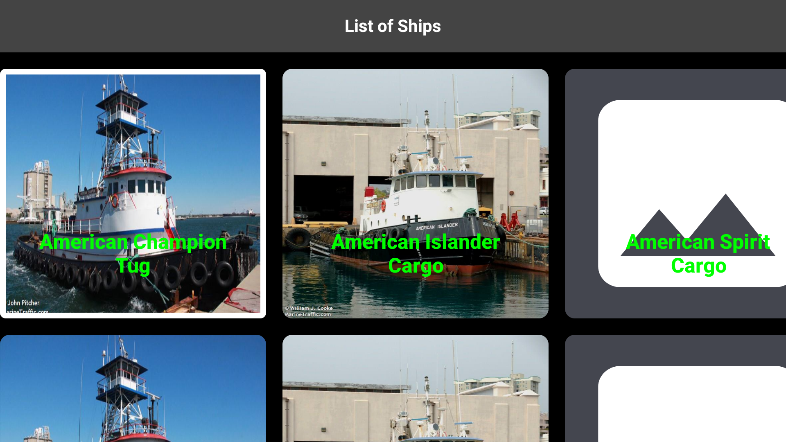

# Sample Android TV App

[](https://linktr.ee/nicos_nicolaou)
[](https://nicosnicolaou16.github.io/)
[](https://twitter.com/nicolaou_nicos)
[](https://linkedin.com/in/nicos-nicolaou-a16720aa)
[](https://medium.com/@nicosnicolaou)
[](https://androiddev.social/@nicolaou_nicos)
[](https://bsky.app/profile/nicolaounicos.bsky.social)
[](https://dev.to/nicosnicolaou16)
[](https://www.youtube.com/@nicosnicolaou16)
[](https://g.dev/nicolaou_nicos)

A modern test implementation for **Android TV OS** using **Jetpack Compose**. This project demonstrates how to handle leanback navigation, remote API integration, and local data persistence.

<a title="simulator_image"></a>

> [!IMPORTANT]  
> Check out the full setup guide here:  
> 👉 **[Android TV Application Setup (Compose & Flutter) - Medium](https://medium.com/@nicosnicolaou/android-tv-application-jetpack-compose-and-flutter-f4decfa765c6)** 👈

> [!IMPORTANT]
> Similar project (Dart/Flutter version):  
> 👉 **[SampleFlutterTVApp](https://github.com/NicosNicolaou16/SampleFlutterTVApp)** 👈

## ✨ Key Features & Technologies

*   **[Android TV OS](https://developer.android.com/tv):** Optimized interface specifically for smart TVs and streaming devices.
*   **[Jetpack Compose for TV](https://developer.android.com/develop/ui/compose):** Modern toolkit for building native TV UIs with focus-aware components.
*   **[Hilt DI](https://developer.android.com/training/dependency-injection/hilt-android):** Dependency injection for clean, testable architecture.
*   **[Room Database](https://developer.android.com/training/data-storage/room):** Local caching and offline support.
*   **[Retrofit](https://square.github.io/retrofit/):** Type-safe HTTP client for fetching SpaceX API data.
*   **[Kotlin Coroutines](https://kotlinlang.org/docs/coroutines-overview.html):** Asynchronous task management.
*   **[MVVM Architecture](https://developer.android.com/topic/architecture):** Separation of concerns using Repositories and ViewModels.
*   **[KSP](https://developer.android.com/build/migrate-to-ksp):** Efficient annotation processing for faster build times.

## 🛠️ Setup

### Manifest Configuration

To support Android TV, you must declare that a touchscreen is not required and specify the Leanback launcher.

```xml

<manifest>

    <uses-feature android:name="android.software.leanback" android:required="false" />

    <uses-feature android:name="android.hardware.touchscreen" android:required="false" />

    <application android:banner="@mipmap/ic_launcher">
        <!--other code here-->
        <activity>
            <!--other code here-->
            <intent-filter>
                <action android:name="android.intent.action.MAIN" />

                <category android:name="android.intent.category.LAUNCHER" />
                <category android:name="android.intent.category.LEANBACK_LAUNCHER" />
            </intent-filter>
        </activity>
        <!--other code here-->
    </application>
</manifest>
```

> [!IMPORTANT]  
> Check my article for the setup :point_right: [Android TV Application (Setup for Jetpack Compose and Flutter)- Medium](https://medium.com/@nicosnicolaou/android-tv-application-jetpack-compose-and-flutter-f4decfa765c6) :point_left: <br />

> [!IMPORTANT]
> Similar project with (Dart Language) :point_right: [SampleFlutterTVApp](https://github.com/NicosNicolaou16/SampleFlutterTVApp) :point_left: <br />

## 🔧 Versioning

- **Target SDK:** **36**
- **Minimum SDK:** **29**
- **Kotlin Version:** **2.3.20**
- **Gradle Version:** **9.1.0**

## 📡 API Reference

This project parses data from the following endpoints:
- **Source:** [SpaceX-API (GitHub)](https://github.com/r-spacex/SpaceX-API)
- **Documentation:** [Postman Docs](https://docs.spacexdata.com/?version=latest)

## 📚 Resources & Tutorials

- [Official TV Playback with Compose](https://developer.android.com/training/tv/playback/compose)
- [Reacting to Focus in Compose](https://developer.android.com/jetpack/compose/touch-input/focus/react-to-focus)
- [Focus Restoration in TV](https://stackoverflow.com/questions/76281554/android-jetpack-compose-tv-focus-restoring)

## ⭐ Stargazers

If you find this project useful, please give it a star!

## 🙏 Support & Contributions

This project is a test implementation. Feedback, bug reports, and feature requests are welcome! Please feel free to **open an issue** or submit a **pull request**.